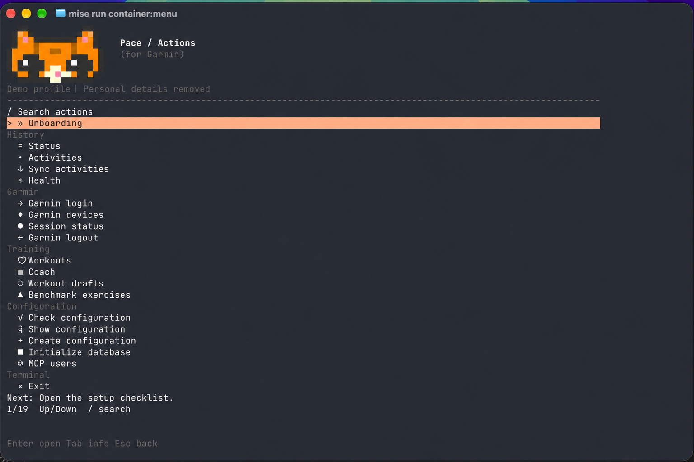

# Garmin Pace

**Your Garmin data, a terminal workspace, and an AI assistant that can help plan your training.**

[](LICENSE)

[Get started](docs/getting-started.md) · [Usage guides](docs/README.md) ·
[CLI](docs/cli.md) · [Coach](docs/coach.md) · [Connect your assistant](docs/assistant.md)

Pace imports Garmin activities, health metrics, workouts and Coach schedules into
local SQLite. Browse them in the terminal or connect an AI assistant through MCP
to review your results and propose training changes. Drafts stay local until you
explicitly save them to Garmin.

One Rust binary. Embedded SQLite. No database server, Python sidecar or browser
runtime. Built for Linux ARM64 devices such as the Raspberry Pi Zero 2 W and
CardputerZero; Podman supports local development on macOS.



*An anonymized illustration of the terminal menu, opened with
`mise run container:menu`. Personal account details have been removed.*

## What you can do

| Workflow | What Pace provides |
| --- | --- |
| Activity history | Import, search and browse completed sessions and recorded strength sets |
| Health and recovery | Sleep, heart rate, HRV, Body Battery, SpO₂, weight, daily summary and readiness |
| Standalone workouts | Browse reusable workouts; draft, review, save and request watch delivery |
| Garmin Coach | Read plans and weekly schedules; review explained changes to individual workouts |
| Strength benchmarks | Inspect exact exercise evidence and review proposed 1RM updates |
| AI access | Local stdio or authenticated HTTP MCP, with separate permission for Garmin operations |

**Status:** early development. Activity and health imports, local drafts, Coach
workout adjustments and Garmin delivery are implemented. The HTTP server has been
run manually on a physical Raspberry Pi; CardputerZero and the installer remain
unvalidated on hardware. See [deployment notes](docs/deployment.md) for measured
results and limits. This is an independent project, not affiliated with Garmin.

## Quick start

Use macOS or Linux with the tools pinned in [mise.toml](mise.toml) and a platform
C/C++ linker toolchain already installed. No tools are installed by these commands.

```sh
git clone https://github.com/tysee/garmin-pace.git
cd garmin-pace
mise trust
mise run build
mise exec -- pace config init
mise exec -- pace init
mise exec -- pace setup
```

The guided setup prepares Garmin access and initial imports. From this checkout,
use `mise exec -- pace …` for the configured development binary, or export it once
for the examples below:

```sh
export PATH="$PWD/target/debug:$PATH"
export GARMIN_PACE_CONFIG="$PWD/config.toml"
pace                     # interactive terminal menu
pace ui --compact        # small-screen layout
```

Prefer not to build? [GitHub Releases](https://github.com/tysee/garmin-pace/releases)
carry installer archives for Linux aarch64 and x86_64 (see
[deployment](docs/deployment.md#raspberry-pi)). Have a release binary already? Put
it on PATH and pass `--config /absolute/path/config.toml`; neither Rust nor mise is
needed at runtime.
Follow [first-time setup](docs/getting-started.md) or the
[Podman workflow](docs/deployment.md#podman-development).

## CLI example: inspect your training week

After setup, replace the dates with your own week. The import reads Garmin and
updates local snapshots; the remaining commands below read those snapshots.

```sh
# Import the Coach week without changing the plan in Garmin.
pace coach sync --start 2026-10-26 --end 2026-11-01

# Inspect the plan, scheduled sessions and recent results.
pace coach show --start 2026-10-26 --end 2026-11-01
pace activities search --sport strength_training --limit 10
pace health show --date 2026-10-25

# Keep standalone workouts and proposed changes easy to find.
pace workout list --standalone
pace workout drafts

# Use structured output in scripts.
pace --json coach show --start 2026-10-26 --end 2026-11-01
```

Activity results and health must be [imported separately](docs/history-and-health.md).
Missing data stays explicit. See [CLI and terminal usage](docs/cli.md) for menu
navigation, pagination and commands against the running Podman profile.

## From results to reviewed changes

```text
Garmin → explicit import → local history and plan
                              ↓
                        AI proposes a draft
                              ↓
                        Review before → after
                              ↓
                     Explicit save → Garmin read-back
```

Example request for a [connected assistant](docs/assistant.md):

> Read my Push, Pull, Legs Coach plan and recent strength results. Propose changes
> for this week, explain the recommended weights and show before → after. Create
> local drafts only; do not save anything to Garmin.

Review the proposals in **Coach → Review drafts** or **Workout drafts**. Approve a
specific revision in a separate instruction to save it. Pace checks the source
revision, journals the write and verifies Garmin's response by reading it back.

Coach remains the calendar interface. Pace edits individual workout definitions;
it does not reschedule sessions, change Coach preferences or replace Garmin's
adaptive algorithm. Nothing adjusts itself in the background. Read the complete
[Coach workflow](docs/coach.md) and [workout save/delivery flow](docs/workouts.md).

## Credentials and privacy

- A **Personal API key** reads activities and seven health datasets.
- A **Connect session** reads readiness, strength sets, workouts, Coach and devices,
  and supports explicit workout and benchmark writes through unofficial endpoints.
- A **Pace access key** authenticates HTTP MCP clients to one local profile.

Health imports need both Garmin credentials. Local MCP reads and local drafts are
available by default; agent access to Garmin requires an administrator grant.
Your assistant's client and model provider receive the data it reads. See
[configuration and privacy](docs/configuration.md) and
[MCP permissions](docs/assistant.md#garmin-writes-from-your-assistant).

## Documentation

Start with the [usage guide index](docs/README.md): setup, CLI, history and health,
Coach, workouts, benchmarks, MCP access, deployment and upgrades.

## Contributing

Bug reports, documentation fixes and focused pull requests are welcome. Read the
[contributing guide](CONTRIBUTING.md) for the development environment, checks and
pull request expectations, and follow the [Code of Conduct](CODE_OF_CONDUCT.md).
Report suspected vulnerabilities privately as described in the
[security policy](SECURITY.md).

## License

[MIT](LICENSE) © 2026 Garmin Pace contributors. Dependencies and the bundled Caddy
keep their own licenses. Garmin trademarks belong to their owners.
